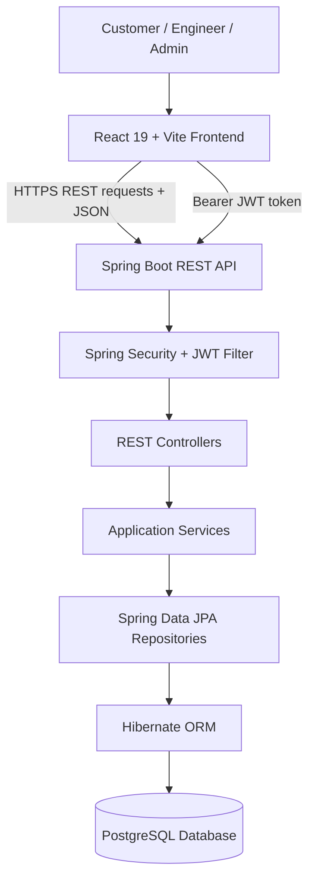
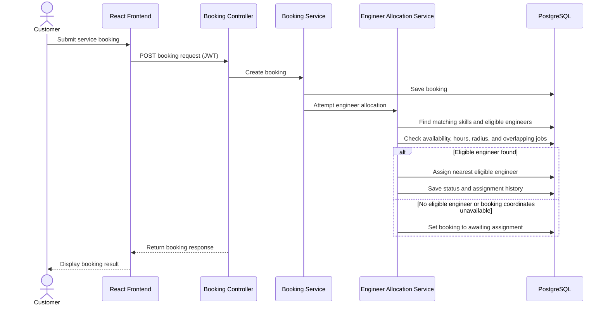

# System Architecture Documentation

## 1. Overview

The Hardware Service Platform is a web application for managing hardware repair and service bookings. It uses a React frontend, a Java 21 / Spring Boot backend, and a PostgreSQL database.

The application is organized into three main layers:

1. **Presentation layer:** React user interface for customers, engineers, and administrators.
2. **Application layer:** Spring Boot REST API containing authentication, booking, engineer allocation, quotation, payment, service-category, and feedback logic.
3. **Data layer:** PostgreSQL database accessed through Spring Data JPA repositories and Hibernate entity mapping.

This document describes the architecture visible in the submitted source code. It does not claim that deployment infrastructure, production database configuration, or runtime behaviour has been independently verified.

## 2. High-Level Architecture

### Component responsibilities

| Component | Responsibility |
|---|---|
| React frontend | Displays role-oriented screens, collects user input, and calls backend endpoints |
| Axios API client | Centralizes the API base URL and attaches the stored JWT as a Bearer token |
| Spring Security | Applies stateless request authentication and permits configured public endpoints |
| JWT filter and service | Extracts and validates the token identity for authenticated requests |
| REST controllers | Expose HTTP endpoints and translate requests into application-service calls |
| Application services | Implement business rules and coordinate repository operations |
| Spring Data JPA repositories | Read and write application entities |
| Hibernate | Maps Java entities to relational database tables |
| PostgreSQL | Persists users, bookings, engineer profiles, skills, status history, quotations, payments, and feedback |

## 3. Frontend Architecture

The frontend is a React single-page application built with Vite and React Router.

### Main frontend areas

- `src/App.jsx`: Defines application routes.
- `src/context/AuthContext.jsx`: Stores authentication state and exposes login, registration-request, and logout functions through React Context.
- `src/services/api.js`: Configures the Axios client, API base URL, JSON content type, and JWT request interceptor.
- `src/pages/auth/`: Authentication screens.
- `src/pages/customer/`: Customer dashboard, booking form, and booking details.
- `src/pages/engineer/`: Engineer dashboard.
- `src/pages/admin/`: Admin dashboard.

### Frontend request flow

1. A user interacts with a page.
2. The page calls the shared Axios client.
3. The Axios request interceptor reads the token from browser local storage.
4. If a token exists, the client adds an `Authorization: Bearer <token>` header.
5. The request is sent to the backend API.
6. The page uses the response to update the interface.

The API base URL is configured through `VITE_API_BASE_URL`. If it is not set, the client uses `http://localhost:8080`, then appends `/api`.

### Current implementation note

The `/register` route currently renders a placeholder component in `App.jsx`. The authentication context has a registration request function, but the route is not yet a completed registration screen. The routes shown in `App.jsx` also do not currently wrap pages in explicit frontend role-protection components. Backend authorization remains important and must be verified for each protected operation.

## 4. Backend Architecture

The backend is a Spring Boot REST application organized by responsibility.

| Package | Responsibility |
|---|---|
| `config` | Security, JWT filter, password encoder configuration |
| `controller` | REST endpoint definitions |
| `dto.request` | Incoming API request models |
| `dto.response` | API response models |
| `entity` | JPA persistence entities |
| `enums` | Roles, service types, and workflow/payment states |
| `repository` | Spring Data JPA data-access interfaces |
| `service` | Business logic and workflow operations |

### Request processing flow

1. The request reaches the Spring Boot application.
2. For authenticated routes, the JWT filter checks for a Bearer token.
3. The token identity is used to load the corresponding user details.
4. Spring Security establishes the authenticated security context when validation succeeds.
5. The request is routed to the matching controller.
6. The controller delegates application logic to a service.
7. The service uses repositories to read or update entities.
8. The result is returned to the frontend as an HTTP response, normally represented as JSON.

## 5. Authentication and Security Architecture

The backend uses Spring Security with stateless JWT authentication.

- The configured public request patterns include `/`, `/error`, `/favicon.ico`, `/api/auth/**`, and `/api/test`.
- Other requests require authentication under the configured security filter chain.
- The JWT authentication filter is registered before Spring Security's username/password authentication filter.
- The application disables form login and HTTP Basic authentication.
- CSRF is disabled for this stateless API configuration.
- Password encoding is configured separately through `PasswordConfig`.
- Method-level security is enabled through `@EnableMethodSecurity`.
- CORS configuration allows the local Vite origin and the configured Netlify frontend origin.
- The frontend stores the token and user summary in browser local storage and sends the token on API requests.

**Security consideration:** Requiring authentication is not the same as enforcing role-based authorization. Role checks must be applied and tested on sensitive controller/service operations. Frontend route visibility alone is not a security boundary. Token storage in local storage also has XSS-related risks and should be reviewed before production use.

## 6. Main Booking Workflow

The booking workflow is coordinated by the booking and engineer-allocation services.

### Booking and allocation sequence

### Automatic engineer allocation criteria

The allocation service checks the following conditions:

1. The engineer has a matching service category and service type skill.
2. The engineer is marked available.
3. The engineer has location coordinates.
4. The requested appointment fits within the engineer's configured working hours.
5. The booking location is within the engineer's configured service radius, based on the Haversine distance calculation.
6. The engineer does not have an overlapping booking in a status other than `CANCELLED` or `COMPLETED`.

Among eligible engineers, the service selects the nearest engineer. If distances are equal, it uses the number of active bookings as a tie-breaker.

If the booking has no coordinates or no eligible engineer is found, the booking is moved to `AWAITING_ASSIGNMENT`.

**Allocation limitations visible in the code:** appointments spanning midnight are not supported. The distance calculation is straight-line geographic distance, not road distance or travel time. Working-hour values must be configured for an engineer to pass the working-hours check.

## 7. Quotation, Payment, and Feedback Modules

The backend has separate controllers, services, repositories, and entities for quotations, payments, and feedback.

- **Quotation:** stores labour cost, parts cost, additional charges, total amount, status, remarks, and response timestamps.
- **Payment:** stores the quotation reference, amount, payment method, transaction reference, payment status, and timestamps.
- **Feedback:** stores a booking reference, customer reference, rating, comment, and creation timestamp.

The presence of these backend modules does not by itself prove that every related frontend workflow is complete or that a real payment gateway is integrated. The payment implementation should be described as a simulated payment flow unless a payment provider integration is added and verified.

## 8. Database Architecture

The application uses PostgreSQL as its relational database. Java entity classes are mapped through Jakarta Persistence annotations and managed by Hibernate.

The main entity groups are:

- **Identity:** `User`
- **Engineer information:** `EngineerProfile`, `EngineerSkill`
- **Service catalogue:** `ServiceCategory`
- **Booking and audit trail:** `Booking`, `BookingStatusHistory`, `AssignmentHistory`
- **Commercial workflow:** `Quotation`, `Payment`
- **Customer feedback:** `Feedback`

The application properties configure the database connection using environment variables:

- `DB_URL`
- `DB_USERNAME`
- `DB_PASSWORD`

The configured Hibernate schema mode is `update`. This lets Hibernate update the schema based on entity mappings, but it is not a substitute for versioned database migrations in a production deployment.

See `DATABASE_SCHEMA.md` and the ER diagram for table-level details and relationships.

## 9. Configuration and Deployment Considerations

The source configuration indicates:

- Backend server port: `PORT`, defaulting to `8080`.
- Database connection: `DB_URL`, `DB_USERNAME`, `DB_PASSWORD`.
- JWT signing secret: `JWT_SECRET`.
- JWT expiration: configured as `86400000` milliseconds (24 hours).
- Frontend API base URL: `VITE_API_BASE_URL`.
- CORS origins: local development frontend and the configured Netlify frontend URL.

Do not commit real secrets or production credentials to source control. Configure them in the relevant deployment environment.

The source code contains a configured frontend origin, but this document does not independently verify the current deployment provider, deployed URL availability, database hosting provider, or production environment variables.

## 10. Known Architecture Gaps and Follow-up Work

The following points should be reviewed before final submission or production use:

1. Complete the frontend registration page and connect it to the existing registration API.
2. Add and test frontend route protection for customer, engineer, and admin roles.
3. Verify backend role authorization for every sensitive operation, including admin-only and engineer-only actions.
4. Complete the frontend integration for engineer availability and job acceptance where required.
5. Complete missing admin workflows, including payment overview and service-category management.
6. Add booking image/file upload if required by the assignment scope.
7. Add service-layer and controller tests for authentication, booking, allocation, quotation, payment, and feedback workflows.
8. Review API validation, error responses, and ownership checks.
9. Consider database migrations rather than relying on Hibernate `ddl-auto=update` for controlled schema changes.
10. Remove diagnostic console output and avoid logging sensitive authentication details.

These are implementation follow-ups, not claims that the application is unusable. Confirm each item against the latest project version before marking it complete or incomplete in the final submission.

## 11. Summary

The project follows a layered client-server architecture. React provides the role-oriented user interface, Spring Boot exposes REST APIs and contains the business logic, Spring Security and JWT handle stateless authentication, and PostgreSQL stores application data through JPA/Hibernate. Booking creation can trigger automatic engineer allocation using skill, availability, working-hour, service-radius, and schedule-overlap checks. Separate backend modules support quotations, payments, and feedback.

This architecture is intended to keep presentation, business logic, security, and persistence responsibilities separated so the application can be maintained and extended.
