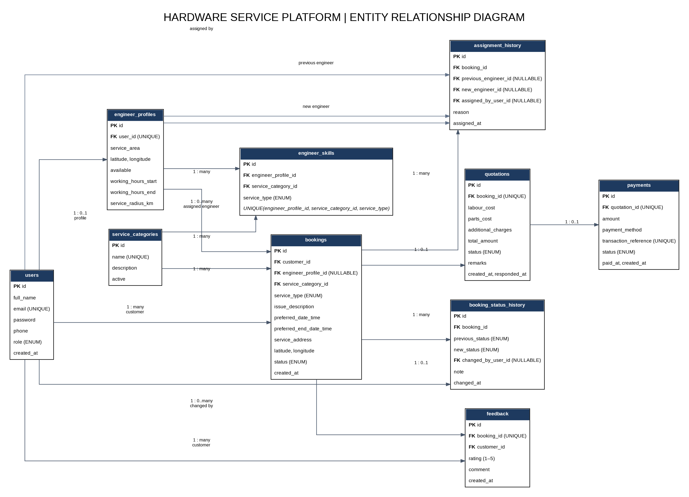

# Entity Relationship Diagram (ERD)

**Project:** Hardware Service & Repair Booking Platform  
**Source of truth:** JPA entity classes in `serviceplatform/src/main/java/com/hardware/serviceplatform/entity/` and enum classes in `.../enums/`.

## Diagram

The diagram represents the entity mappings currently present in the submitted source snapshot. It is not a proposed redesign.

## Entities

| Entity / table | Purpose |
|---|---|
| `users` | Stores customer, engineer and administrator accounts. The `role` field distinguishes the account role. |
| `engineer_profiles` | Stores an engineer's service area, coordinates, availability, working hours and service radius. Each profile belongs to one user. |
| `service_categories` | Stores the device/service categories offered by the platform. |
| `engineer_skills` | Associates an engineer profile with a service category and supported service type. A unique constraint prevents duplicate combinations. |
| `bookings` | Stores the customer's service request, service location, preferred time, selected category, assigned engineer and current status. |
| `booking_status_history` | Records each booking status transition, including the previous and new status and the user who changed it when applicable. |
| `assignment_history` | Records booking engineer assignment/reassignment, including previous engineer, new engineer, assigning user and reason. |
| `quotations` | Stores labour, parts and additional charges, total amount, quotation status and customer response timestamps for a booking. |
| `payments` | Stores a payment against a quotation, including amount, method, transaction reference, status and timestamps. |
| `feedback` | Stores a customer's rating and comment for a booking. A booking can have at most one feedback record. |

## Relationships and cardinalities

- `users` 1 to 0..1 `engineer_profiles`: `engineer_profiles.user_id` is a non-null unique foreign key.
- `users` 1 to many `bookings`: `bookings.customer_id` identifies the customer who created the booking.
- `engineer_profiles` 1 to 0..many `bookings`: `bookings.engineer_profile_id` is nullable because a booking may await assignment.
- `service_categories` 1 to many `bookings`: every booking references one service category.
- `engineer_profiles` 1 to many `engineer_skills`; `service_categories` 1 to many `engineer_skills`.
- `bookings` 1 to many `booking_status_history`; each history row belongs to one booking.
- `users` 1 to 0..many `booking_status_history`: `changed_by_user_id` is nullable for system-generated status changes.
- `bookings` 1 to many `assignment_history`; each assignment-history row belongs to one booking.
- `engineer_profiles` can be referenced by many assignment-history rows in two distinct roles: `previous_engineer_id` and `new_engineer_id`. Both are nullable.
- `users` 1 to 0..many `assignment_history` through the nullable `assigned_by_user_id` reference.
- `bookings` 1 to 0..1 `quotations`: `quotations.booking_id` is non-null and unique.
- `quotations` 1 to 0..1 `payments`: `payments.quotation_id` is non-null and unique.
- `bookings` 1 to 0..1 `feedback`: `feedback.booking_id` is non-null and unique.
- `users` 1 to many `feedback`: each feedback record references the customer who submitted it.

## Enum fields

These values are represented as strings in the mapped entities (`EnumType.STRING`):

- `Role`: `CUSTOMER`, `ENGINEER`, `ADMIN`
- `ServiceType`: `REPAIR`, `INSTALLATION`, `MAINTENANCE`, `DIAGNOSIS`
- `BookingStatus`: `REQUEST_RECEIVED`, `AWAITING_ASSIGNMENT`, `ENGINEER_ASSIGNED`, `ACCEPTED`, `ON_THE_WAY`, `ARRIVED`, `QUOTATION_SHARED`, `WORK_IN_PROGRESS`, `COMPLETED`, `CANCELLED`
- `QuotationStatus`: `PENDING`, `APPROVED`, `REJECTED`
- `PaymentStatus`: `PENDING`, `SUCCESSFUL`, `REFUNDED`, `FAILED`

## Important mapping notes

- Primary keys use JPA `GenerationType.IDENTITY`.
- The diagram labels foreign keys from the `@JoinColumn` mappings. It does not imply additional relationships that are not represented in the entity classes.
- `engineer_skills` has a composite unique constraint across `engineer_profile_id`, `service_category_id` and `service_type`; its primary key remains the separate `id` column.
- `quotations.booking_id`, `payments.quotation_id` and `feedback.booking_id` are unique, enforcing the one-to-one mappings at the database level.
- Some nullable fields are intentionally marked in the diagram where the entity mapping permits nulls, particularly unassigned bookings and system/admin audit references.
- Exact SQL column types and database constraint names are determined by Hibernate/PostgreSQL schema generation. This ERD documents the JPA model, not a database introspection export.
